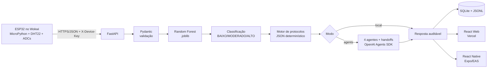

# Arquitetura ponta a ponta — CardioIA 2.0

## Decisões arquiteturais
- **Cálculo crítico determinístico:** o LLM não calcula probabilidade, faixa ou protocolo.
- **Contrato único:** `PatientData` alimenta CLI, API e modelo; `SensorReading` estende-o apenas com metadados IoT.
- **Dois modos:** `local` funciona sem chave; `agents` evidencia tools, handoffs, memória SQLite e saída Pydantic.
- **Persistência mínima:** SQLite elimina infraestrutura externa no MVP, com índice por dispositivo/tempo.
- **Segurança:** chave do sensor via header, CORS explícito, segredos por ambiente, validação estrita e usuário não-root no container.
- **Observabilidade:** `/health`, log JSONL com fingerprint e histórico de leituras/decisões.

## Sequência
1. ESP32 conecta à `Wokwi-GUEST`, lê DHT22 e quatro ADCs e envia `SensorReading`.
2. FastAPI valida autenticação e esquema; payload inválido retorna 422.
3. O pipeline carrega o modelo versionado, produz probabilidade e classifica pelos limites 0,30/0,70.
4. Regras em `data/protocolos.json` geram recomendações sem `eval` ou texto inventado.
5. Opcionalmente, agentes coordenam validação, inferência, protocolos e consolidação.
6. A resposta é persistida e consumida por web e mobile.

## Limites
Dados, rótulos, limites e protocolos são sintéticos. O sistema não é dispositivo médico, não foi validado clinicamente e requer revisão humana.
